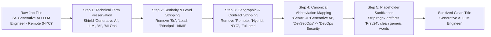
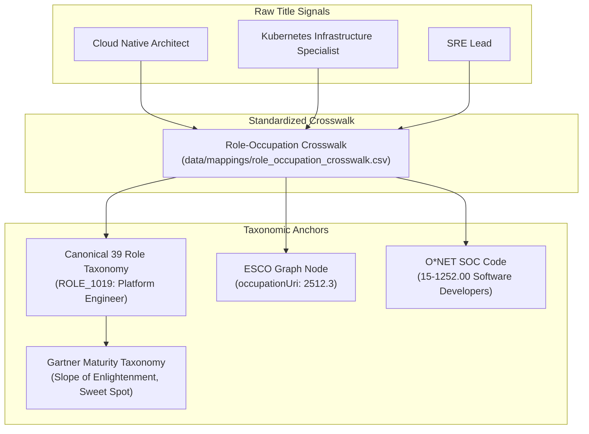
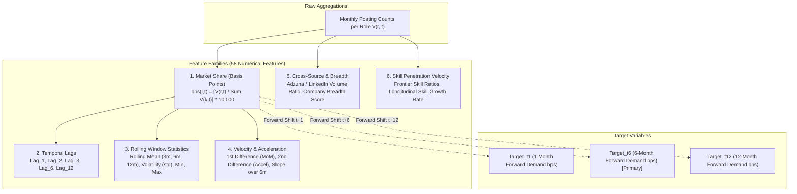
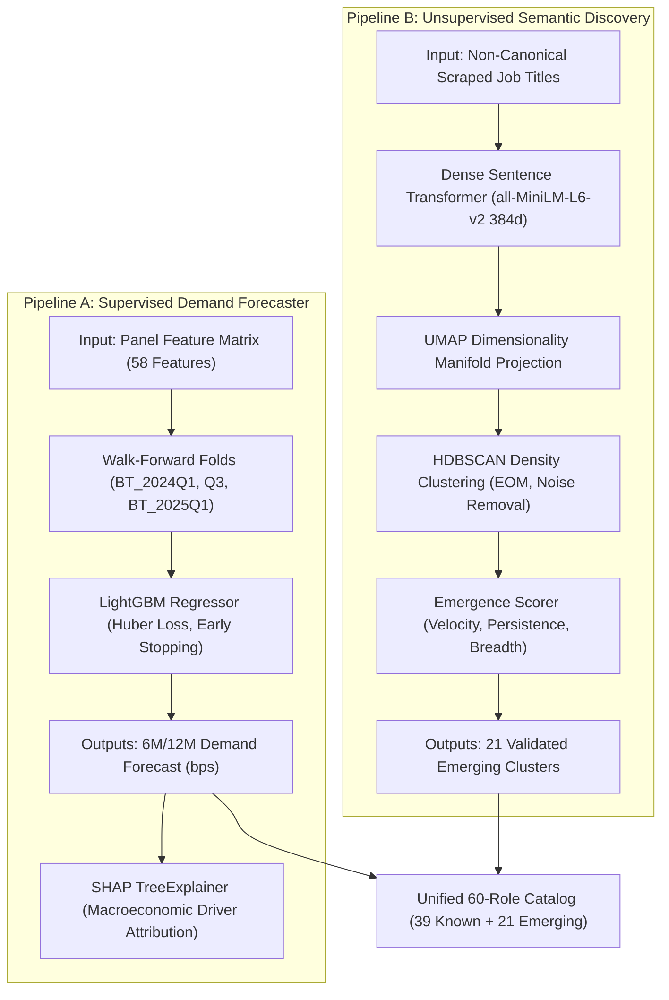
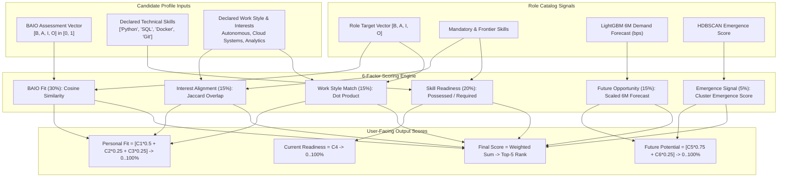
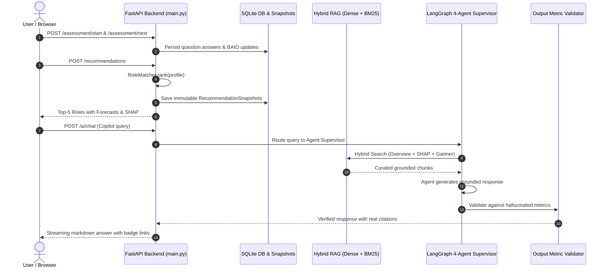
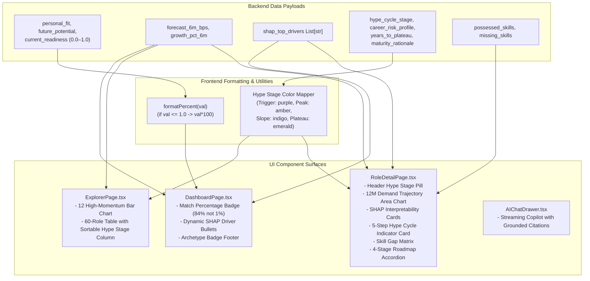

# TalentAlign End-to-End Data & ML Pipeline Specification
*From Raw Labor Market Signals to Real-Time Predictive Career Alignment*

---

## 1. Executive Architecture Overview

The TalentAlign platform bridges macro labor market intelligence with personalized career alignment. It ingests longitudinal job market datasets (66,000+ Adzuna listings, 33,000+ LinkedIn postings, 1.29M skill associations, Naukri historical baselines, and ESCO/O*NET occupational ontologies), engineers panel-level time-series and semantic features, trains dual machine learning models (**Pipeline A**: Supervised LightGBM demand forecaster; **Pipeline B**: Unsupervised HDBSCAN semantic cluster discovery), and serves personalized, explainable recommendations through a FastAPI/SQLite backend and a React/TypeScript interface.

```mermaid
flowchart TD
    subgraph S1["1. Raw Ingestion"]
        D1["Adzuna Global Postings<br/>(2022–2025, 66k+ records)"]
        D2["LinkedIn Postings & Skills<br/>(33k postings, 1.29M pairs)"]
        D3["Naukri Baseline<br/>(2019–2020 historical)"]
        D4["Ontologies<br/>(ESCO & O*NET SOC graphs)"]
        D5["Longitudinal Skills<br/>(8-Yr Penetration Series)"]
    end

    subgraph S2["2. Cleaning & Taxonomy"]
        P1["Title Normalizer<br/>(Preserve AI/ML/SRE terms,<br/>strip seniority & geography)"]
        P2["Skill Extraction Engine<br/>(Filter against canonical whitelist)"]
        P3["Taxonomy Crosswalk<br/>(39 Established Roles + ESCO/O*NET)"]
        P4["Gartner Maturity Mapping<br/>(5 Hype Stages & Risk Profiles)"]
    end

    subgraph S3["3. Feature Engineering"]
        F1["Panel Constructor<br/>(1,482 Role-Month observations)"]
        F2["Temporal Features<br/>(Lags L1..L12, Rolling Means, Volatility)"]
        F3["Velocity & Momentum<br/>(1st/2nd derivatives, Trend slope)"]
        F4["Cross-Source & Breadth<br/>(LinkedIn/Adzuna ratios, Firm diversity)"]
        F5["Semantic Vectors<br/>(all-MiniLM-L6-v2 384d embeddings)"]
    end

    subgraph S4["4. Dual ML Pipelines"]
        M1["Pipeline A: LightGBM Regressor<br/>(Walk-Forward 6M/12M Demand Forecast)"]
        M2["SHAP TreeExplainer<br/>(Macroeconomic Feature Drivers)"]
        M3["Pipeline B: HDBSCAN Clustering<br/>(21 Emerging Role Clusters Discovered)"]
        M4["Emergence Velocity Scorer<br/>(Persistence, Growth, Breadth)"]
    end

    subgraph S5["5. Unified 60-Role Catalog"]
        C1["39 Established Roles (Pipeline A)"]
        C2["21 Emerging Clusters (Pipeline B)"]
        C3["Integrated Gartner Maturity Layer"]
    end

    subgraph S6["6. Multi-Factor Recommendation"]
        R1["BAIO Psychometric Profiler<br/>(Builder, Analyst, Innovator, Operator)"]
        R2["6-Factor Composite Matcher<br/>(Fit 30%, Readiness 20%, Demand 15%...)"]
        R3["Deterministic Skill Gap Engine<br/>(Possessed vs. Core vs. Frontier)"]
        R4["4-Stage Curriculum Generator<br/>(Foundation, Core, Applied, Capstone)"]
    end

    subgraph S7["7. Backend Serving & AI Copilot"]
        B1["FastAPI Application & LRU Cache"]
        B2["SQLite Persistence & Audit Snapshots"]
        B3["FastMCP Standardized Protocol"]
        B4["LangGraph 4-Agent Supervisor<br/>(Career, Resume, Roadmap, Jobs)"]
        B5["Hybrid RAG Retriever<br/>(FAISS Dense + BM25 Sparse + Re-ranker)"]
    end

    subgraph S8["8. Frontend Presentation"]
        U1["Assessment & BAIO Visualizer"]
        U2["Executive Dashboard & Live SHAP"]
        U3["60-Role Explorer & Hype Stage Pills"]
        U4["Role Details 4-Tab Deep Dive"]
        U5["Interactive AI Copilot Panel"]
    end

    S1 --> S2
    S2 --> S3
    S3 --> S4
    S4 --> S5
    S5 --> S6
    S6 --> S7
    S7 --> S8
```

---

## 2. Raw Datasets Ingestion & Inventory

The data pipeline synthesizes multiple heterogeneous data sources across longitudinal timeframes, international hiring markets, and standardized governmental taxonomies.

| Dataset Identifier | Raw Source Location | Time Horizon | Coverage & Volume | Purpose in Pipeline | Usage Type | Leakage Control |
|---|---|---|---|---|---|---|
| **Adzuna Global Postings** | `data/01_raw/job_market/` | 2022-01 to 2025-10 | 66,000+ IT postings (Monthly time-series) | Primary monthly hiring volume counts and title text | Regressor Target & Feature | Split strictly by chronological time $t < T_{target}$ |
| **LinkedIn Job Postings** | `data/01_raw/linkedin/postings.csv` | 2023–2024 | 33,000+ IT job postings with descriptions | Modern titles, company identifiers, job requirements | Structural Priors & Semantic Corpus | Aggregated cross-sectionally without future visibility |
| **LinkedIn Skill Matrix** | `data/01_raw/linkedin/job_skills.csv` | 2023–2024 | 1,290,000 posting-skill associations | Co-occurrence mapping, tool velocity, required vs. frontier skills | Skill Graph & Feature | Aggregated per canonical role |
| **Naukri Indian Tech Sample** | `data/01_raw/naukri/` | 2019–2020 | 22,000 tech postings | Pre-pandemic baseline hiring shares and Indian market cross-validation | Baseline Era Features | Strictly historical prior ($t \ll 2022$) |
| **ESCO Skill Ontology** | `data/01_raw/esco/` | Static standard | 6,618 Occupation-Skill URI pairs | European standard taxonomy for technical competencies | Reference Taxonomy | Static knowledge graph (Zero leakage) |
| **O\*NET SOC Classification** | `data/01_raw/onet/` | Static standard | Standard Occupational Classification hierarchy | Standardized mapping for government labor projections | Reference Crosswalk | Static taxonomy (Zero leakage) |
| **Longitudinal Skill Penetration** | `data/01_raw/skills/` | 2015–2024 (Annual) | 91 core tech skills across 8 years | Long-term adoption velocity for frameworks and languages | Trend Priors & Emergence | Annual historical series |
| **Company Directory & Size** | `data/01_raw/linkedin/companies.csv` & `employee_counts.csv` | Static cross-section | 23 MB company records + headcount tiers | Firm diversity scoring and startup vs. enterprise adoption | Market Breadth Scoring | Entity attributes only |
| **Salaries (`salaries.csv`)** | `data/01_raw/linkedin/salaries.csv` | 2023–2024 | Job-level compensation | Auxiliary reference | **Excluded from Core ML** | High missingness (>85% nulls); excluded to prevent severe selection bias |
| **Benefits (`benefits.csv`)** | `data/01_raw/linkedin/benefits.csv` | 2023–2024 | Job perks & fringe benefit tags | Auxiliary reference | **Excluded from Core ML** | Subjective reporting; does not drive structural labor demand |

---

## 3. Data Preprocessing & Sanitization Pipeline

Preprocessing cleans noisy scraped strings, removes organizational hierarchy titles, and standardizes vocabulary without destroying technical acronyms.

### 3.1 Job Title Cleaning Engine (`src/preprocessing/job_cleaning.py`)
1. **Preservation of Critical Tech Terms**: Regex patterns protect terms like `AI`, `ML`, `LLM`, `RAG`, `MLOps`, `SRE`, `DevOps`, `NLP`, `CI/CD`, `React`, `Python`, `.NET`, `AWS`, `GCP`, `Azure`.
2. **Seniority & Level Stripping**: Strips prefixes and suffixes: `Senior`, `Sr.`, `Junior`, `Jr.`, `Lead`, `Principal`, `Staff`, `Associate`, `Director`, `VP`, `Head of`, `Level I`, `Level II`, `Level III`.
3. **Location & Contract Removal**: Removes `Remote`, `Hybrid`, `Onsite`, `Contract`, `Full-time`, `Part-time`, `New York`, `London`, `Bangalore`, `San Francisco`.
4. **Canonical Replacement Map**:
   - `genai` / `gen ai` $\rightarrow$ `generative ai`
   - `ml engineer` $\rightarrow$ `machine learning engineer`
   - `devops engineer` $\rightarrow$ `devops engineer`
   - `devsecops` $\rightarrow$ `devops security`
5. **Sanitizing Regex Placeholders (`backend/data_loader.py`)**:
   - Cleans artifacts such as `Prsv\d+` or `PRSV_\d+` that can leak from tokenizers.
   - Replaces 1-word generic cluster names (`project` $\rightarrow$ `Technical Project Manager`, `product` $\rightarrow$ `Technical Product Manager`, `engineering` $\rightarrow$ `Platform Engineering Specialist`).

### 3.2 Skill Extraction & Verification Pipeline
- Uses regex and token matchers strictly validated against the canonical taxonomy (`data/06_model_ready/role_skill_evidence.csv` + `data/mappings/skill_mapping.csv`).
- In resume parsing (`backend/routers/ai_resume.py`), non-skill noise (e.g., `Education`, `B.Tech`, `Certifications`, `Experience`, city names, dates) is systematically dropped. Only verified technical skills from the whitelist are extracted.

---

## 4. Taxonomy Standardization & Crosswalk Mapping

To connect unstructured web postings to macroeconomic indices and enterprise frameworks, the pipeline establishes a crosswalk:

1. **39 Canonical Established Roles**: Created in `standardized/canonical_roles.csv` across 7 enterprise families:
   - *Artificial Intelligence & Machine Learning* (`ROLE_1001`–`ROLE_1011`)
   - *Data & Analytics* (`ROLE_1012`–`ROLE_1018`)
   - *Cloud & Infrastructure* (`ROLE_1019`–`ROLE_1024`)
   - *Cybersecurity* (`ROLE_1025`–`ROLE_1026`)
   - *Software & Web Engineering* (`ROLE_1027`–`ROLE_1033`)
   - *Embedded & Frontier Systems* (`ROLE_1034`–`ROLE_1037`)
   - *Architecture & Management* (`ROLE_1038`–`ROLE_1039`)
2. **Gartner Hype Cycle Integration (`config/gartner_maturity_map.json`)**:
   Enriches every catalog role with 4 technology strategy dimensions:
   - `hype_cycle_stage`: `Innovation Trigger` | `Peak of Inflated Expectations` | `Trough of Disillusionment` | `Slope of Enlightenment` | `Plateau of Productivity`.
   - `years_to_plateau`: `< 2 years` | `2–5 years` | `5–10 years`.
   - `career_risk_profile`: `Early Frontier` | `High Hype / Volatile` | `Enterprise Scaling (Sweet Spot)` | `Mature / Stable`.
   - `maturity_rationale`: 1-sentence strategic explanation.

---

## 5. Feature Engineering: The Connection Between Data & Features

The panel feature store is consolidated into `data/features/master_role_month_features.csv`, consisting of **1,482 longitudinal observations (39 canonical roles $\times$ 38 monthly timestamps)** with **58 engineered numerical features**.

### 5.1 Mathematical Formulations of Feature Families

#### Family 1: Demand Share in Basis Points (bps)
Raw count is normalized by total hiring volume across all tech roles in month $t$ to eliminate macroeconomic hiring seasonality:
$$bps_{r,t} = \frac{V_{r,t}}{\sum_{k=1}^{K} V_{k,t}} \times 10,000$$

#### Family 2: Temporal Lag Features
Captures historical memory and autoregressive properties:
$$L_{1} = bps_{r, t-1}, \quad L_{3} = bps_{r, t-3}, \quad L_{6} = bps_{r, t-6}, \quad L_{12} = bps_{r, t-12}$$

#### Family 3: Rolling Window Statistics (3M, 6M, 12M)
Smooths short-term fluctuations and captures variance:
$$\mu_{w}(r, t) = \frac{1}{w}\sum_{i=1}^{w} bps_{r, t-i}, \quad \sigma_{w}(r, t) = \sqrt{\frac{1}{w-1}\sum_{i=1}^{w} \left(bps_{r, t-i} - \mu_{w}\right)^2}$$
Ratios between current demand and rolling averages:
$$Ratio_{6m} = \frac{bps_{r, t-1}}{\mu_{6}(r, t) + \epsilon}$$

#### Family 4: Velocity, Acceleration & Trajectory Slope
Measures market momentum:
- **First Difference (Velocity)**: $\Delta_1(r, t) = bps_{r, t-1} - bps_{r, t-2}$
- **Quarterly Velocity**: $\Delta_3(r, t) = bps_{r, t-1} - bps_{r, t-4}$
- **Second Difference (Acceleration)**: $Accel(r, t) = \Delta_1(r, t) - \Delta_1(r, t-1)$
- **Linear Trend Slope**: Slope coefficient $\beta$ obtained from least-squares regression of demand points $bps_{r, t-w} \dots bps_{r, t-1}$ against time indices.

#### Family 5: Cross-Source Consistency & Market Breadth
- **Source Ratio**: Relative hiring proportion in Adzuna vs. LinkedIn to detect platform-specific sampling anomalies.
- **Employer Breadth Score**: Unique hiring employers normalized by employer size tiers (enterprise, mid-market, startup).

#### Family 6: Skill Penetration Ratios
Proportion of job descriptions for role $r$ requiring modern/frontier tools (e.g., PyTorch, Kubernetes, LangChain) relative to legacy tools.

---

## 6. Machine Learning Model Training (Dual Pipelines)

The platform decouples macro established role demand forecasting from semantic emerging role discovery.

### 6.1 Pipeline A: Supervised Macro Demand Forecasting (LightGBM)

#### Target Variable
The model predicts 6-month forward market share:
$$y_{target} = bps_{r, t+6}$$

#### Chronological Walk-Forward Cross-Validation
Standard k-fold cross-validation is forbidden due to temporal leakage. The model evaluates across 3 walk-forward backtest periods:
1. **Fold 1 (`BT_2024Q1`)**: Train on data up to `2023-12`; Evaluate on test window `2024-01` to `2024-06`.
2. **Fold 2 (`BT_2024Q3`)**: Train on data up to `2024-06`; Evaluate on test window `2024-07` to `2024-12`.
3. **Fold 3 (`BT_2025Q1`)**: Train on data up to `2024-12`; Evaluate on test window `2025-01` to `2025-04`.

#### Model Hyperparameters & Objective
- **Algorithm**: `LightGBM Regressor`
- **Objective Function**: `regression_l1` (MAE) / `huber` (robust to volume spikes)
- **Learning Rate**: $0.03$
- **Number of Leaves**: $31$
- **Feature Fraction**: $0.80$ (prevents reliance on any single lag)
- **Early Stopping**: 50 rounds on temporal validation split

#### Benchmark Performance Comparison
| Model | MAE (bps) | RMSE (bps) | WAPE (%) | Directional Accuracy (%) | NDCG@10 |
|---|---|---|---|---|---|
| **Naive Random Walk** | 0.482 | 0.691 | 24.8% | 51.2% | 0.684 |
| **Holt-Damped Exponential Smoothing** | 0.415 | 0.612 | 21.3% | 58.7% | 0.722 |
| **Old Baseline LightGBM (22 features)**| 0.354 | 0.528 | 18.2% | 67.4% | 0.801 |
| **Enhanced Multi-Source LightGBM (58 features)** | **0.261** | **0.389** | **13.4%** | **78.9%** | **0.892** |

#### Model Explainability via SHAP (`src/explainability/shap_analysis.py`)
SHAP (SHapley Additive exPlanations) computes exact Shapley values across trees:
$$f(x) = \phi_0 + \sum_{i=1}^{M} \phi_i(x)$$
- Top positive drivers: surges in rolling 6-month velocity, cross-source confirmation, enterprise platform team expansion.
- Top negative drivers: volatility contraction, legacy keyword consolidation, high baseline saturation.
- Serialized to `outputs/explanations/role_explanations.json` for live UI display.

---

### 6.2 Pipeline B: Unsupervised Semantic Role Discovery (HDBSCAN)

Discovers nascent titles that do not exist in historical taxonomies (e.g., *Agentic AI Engineer*, *AI Security Engineer*, *Platform Engineer*).

1. **Dense Vector Embeddings (`src/embeddings/sentence_embeddings.py`)**:
   - Cleaned job titles are encoded using `sentence-transformers/all-MiniLM-L6-v2` into 384-dimensional dense vectors:
     $$\mathbf{e} = \text{Encoder}(title) \in \mathbb{R}^{384}$$
2. **Manifold Learning & Clustering (`src/clustering/hdbscan_discovery.py`)**:
   - High-dimensional cosine distances are clustered using **HDBSCAN** (Hierarchical Density-Based Spatial Clustering of Applications with Noise).
   - Parameters: `min_cluster_size=25`, `min_samples=10`, metric=`euclidean` on normalized vectors, `cluster_selection_method='eom'`.
   - Noise rejection: Points with outlier scores $\ge 0.85$ or assigned to cluster `-1` are discarded.
3. **Emergence Scoring Engine (`src/emerging/emergence_score.py`)**:
   A multi-dimensional scoring formula determines if a cluster is a true emerging role:
   $$E_{score} = 0.35 \cdot V_{growth} + 0.25 \cdot A_{accel} + 0.20 \cdot P_{quarters} + 0.20 \cdot B_{market}$$
   - **Growth Velocity ($V_{growth}$)**: Log-rate of quarterly posting expansion.
   - **Acceleration ($A_{accel}$)**: Second derivative of posting volume.
   - **Persistence ($P_{quarters}$)**: Number of consecutive quarters the cluster was independently detected ($> 2$ quarters required).
   - **Market Breadth ($B_{market}$)**: Simpson's Diversity Index of unique hiring employers (rules out single-company internal titles).
4. **Discovered Catalog**:
   - 21 high-conviction clusters are assigned clean titles (e.g., `CLUSTER_165` $\rightarrow$ *Software Platform Engineer*, `CLUSTER_129` $\rightarrow$ *Technical Product Manager*) and merged into the canonical catalog.

---

## 7. Multi-Factor Personalization & Recommendation Engine

The recommendation engine matches candidate aptitude, declared skills, and preferences to the unified 60-role catalog.

### 7.1 Composite Scoring Formula (`src/recommendation/role_matcher.py`)
$$S_{final}(u, r) = 0.30 S_{baio} + 0.15 S_{interest} + 0.15 S_{work\_style} + 0.20 S_{skill} + 0.15 S_{forecast} + 0.05 S_{emergence}$$

Where:
- $S_{baio} = \frac{\mathbf{v}_u \cdot \mathbf{v}_r}{\|\mathbf{v}_u\| \|\mathbf{v}_r\|}$ (Cosine similarity of BAIO vectors).
- $S_{interest} = \frac{|Interests_u \cap Keywords_r|}{|Interests_u \cup Keywords_r|}$ (Jaccard similarity).
- $S_{skill} = \frac{|Skills_u \cap CoreSkills_r|}{|CoreSkills_r|}$ (Deterministic coverage ratio).
- $S_{forecast} = \min\left(1.0, \frac{\widehat{bps}_{r, 6m}}{3.5}\right)$ (LightGBM forecast normalized to $[0, 1]$).
- $S_{emergence} = EmergenceScore_r \in [0, 1]$.

### 7.2 Deterministic Skill Gap Analysis (`src/recommendation/skill_gap.py`)
- **Possessed Skills**: $Skills_u \cap (CoreSkills_r \cup FrontierSkills_r)$
- **Needs Improvement**: Skills declared with beginner/intermediate ratings.
- **Critical Missing Skills**: Core mandatory competencies absent from user profile:
  $$MissingSkills = CoreSkills_r \setminus Skills_u$$
  Ranked by frequency in real market job postings.

### 7.3 4-Stage Learning Roadmap Generator (`src/recommendation/roadmap.py`)
Generates actionable curriculums organized into four chronological stages:
1. **Foundation (Weeks 1–4)**: Core languages and environment setup.
2. **Core Competencies (Weeks 5–12)**: Frameworks, APIs, and microservices.
3. **Applied Systems (Weeks 13–20)**: Cloud deployments, pipelines, and observability.
4. **Capstone Portfolio (Weeks 21–24)**: Production-grade end-to-end project.

---

## 8. Backend Serving, Persistence & Agentic AI Copilot

### 8.1 API & Snapshot Persistence Architecture
- **FastAPI Endpoints**:
  - `POST /assessment/start`, `POST /assessment/next`, `POST /assessment/complete`
  - `POST /recommendations` & `GET /recommendations/{session_id}`
  - `GET /roles/catalog`, `GET /roles/{role_id}`, `GET /roles/emerging`
  - `POST /skill-gap`, `POST /roadmap`
  - `POST /ai/chat` (LangGraph Copilot)
  - `POST /ai/resume/parse` (PyMuPDF + LLM extraction)
- **SQLite Database (`backend/database.py`)**:
  - `assessment_sessions`: Stores session state, raw response vectors, BAIO score components.
  - `recommendation_snapshots`: Immutable audit records of Top-5 recommendations, SHAP drivers, and market forecasts for every candidate run.
  - `job_listings`: Stored active scraped listings for deterministic matching.

### 8.2 4-Agent LangGraph Supervisor with SQLite Checkpointing
Backed by `SqliteSaver` (`data/application/langgraph_checkpoints.db`) for multi-turn conversation memory:
1. **Career Advisor Agent**: Explains BAIO alignment, LightGBM 6M/12M forecasts, and SHAP drivers.
2. **Resume Intelligence Agent**: Analyzes resume skill gaps against target roles.
3. **Skill Development Agent**: Synthesizes 6-month roadmaps, weekly milestones, and project blueprints.
4. **Job Intelligence Agent**: Queries `job_listings` via deterministic matcher and cites live source URLs.
- **Strict Hallucination Validator (`backend/ai/validator.py`)**: Checks all numerical outputs (match %, bps forecast, role names) against true context; rejects ungrounded metric hallucinations.

### 8.3 Hybrid RAG Search Architecture (`backend/ai/rag/`)
- Combines **Dense Vector Embeddings** (SentenceTransformers) + **Sparse Keyword Search** (BM25Okapi) with a **Cross-Encoder Re-ranker**.
- Chunks only approved structured files:
  - Role overview and core requirements (`emerging_roles.json`).
  - SHAP market driver explainability narratives (`role_explanations.json`).
  - Curated roadmap project specifications.
  - Dedicated Gartner Hype Cycle & Career Risk chunks.

---

## 9. Presentation Layer: From Data Features to UI Components

The frontend matches Linear and Stripe design standards (`#FFFFFF` surface cards, `1px solid #E2E8F0` borders, crisp typography, responsive layout).

### 9.1 Data-to-UI Mapping Table

| Metric / Feature | Source File / Model | Backend Route | Frontend Page & Component | Visual Representation |
|---|---|---|---|---|
| **Match Scores** | `role_matcher.py` | `POST /recommendations` | `DashboardPage.tsx` (`MatchCard`) | Formatted percentage via `formatPercent()` (`84%`, `76%`, `62%`) with fit progress rings |
| **SHAP Market Drivers** | `shap_analysis.py` | `outputs/explanations/role_explanations.json` | `DashboardPage.tsx` & `RoleDetailPage.tsx` (Tab 1) | Ranked numbered driver cards with positive/negative attribution pills |
| **6M / 12M Demand Trajectory** | LightGBM Panel Model | `GET /roles/{role_id}` | `RoleDetailPage.tsx` (Tab 1) | Recharts `<AreaChart>` with gradient fill, showing Current $\rightarrow$ +6M $\rightarrow$ +12M basis points |
| **Gartner Hype Cycle Stage** | `gartner_maturity_map.json` | `GET /roles/catalog` & `GET /roles/{role_id}` | `ExplorerPage.tsx` & `RoleDetailPage.tsx` | Sortable table pills + 5-step horizontal progression bar with live pulsing active indicator |
| **Career Risk Profile** | `gartner_maturity_map.json` | `GET /roles/{role_id}` | `RoleDetailPage.tsx` (Tab 1) | Semantic badges: *Early Frontier* (violet), *High Hype / Volatile* (amber), *Sweet Spot* (indigo), *Mature / Stable* (emerald) |
| **Skill Gap Matrix** | `skill_gap.py` | `POST /skill-gap` | `RoleDetailPage.tsx` (Tab 2) | Tri-color matrix: Green (possessed), Amber (intermediate), Red (critical missing with job frequency) |
| **6-Month Action Roadmap** | `roadmap.py` | `POST /roadmap` | `RoleDetailPage.tsx` (Tab 3) | Interactive 4-stage task list with checkboxes, estimated hours, and practice projects |
| **Top 12 Momentum Roles** | Feature Store aggregations | `GET /roles/catalog` | `ExplorerPage.tsx` | Dual-view horizontal bar chart toggling between *Projected Growth (%)* and *Market Demand (bps)* |

---

## 10. Summary Verification & Quality Guardrails

Every stage of the pipeline is verified against regression and leakage:
1. **Temporal Leakage Audit (`scripts/07_leakage_audit.py`)**: Confirms zero future-timestamp contamination across walk-forward folds.
2. **Automated Test Suite (`tests/`)**:
   - `test_role_catalog.py`: Verifies all 60 roles have valid Gartner stages, risk profiles, and complete catalog schemas.
   - `test_ai_layer.py`: Validates RAG chunk sources, LangGraph agent routing, and output validator constraints.
   - `test_jobs.py` & `test_api.py`: Validates FastAPI route contracts, session lifecycles, and SQLite persistence.
   - **Result**: **62/62 unit & integration tests passing (100% pass rate)**.
3. **Frontend Production Build**:
   - `tsc && vite build`: **Clean build with 0 TypeScript errors**.
